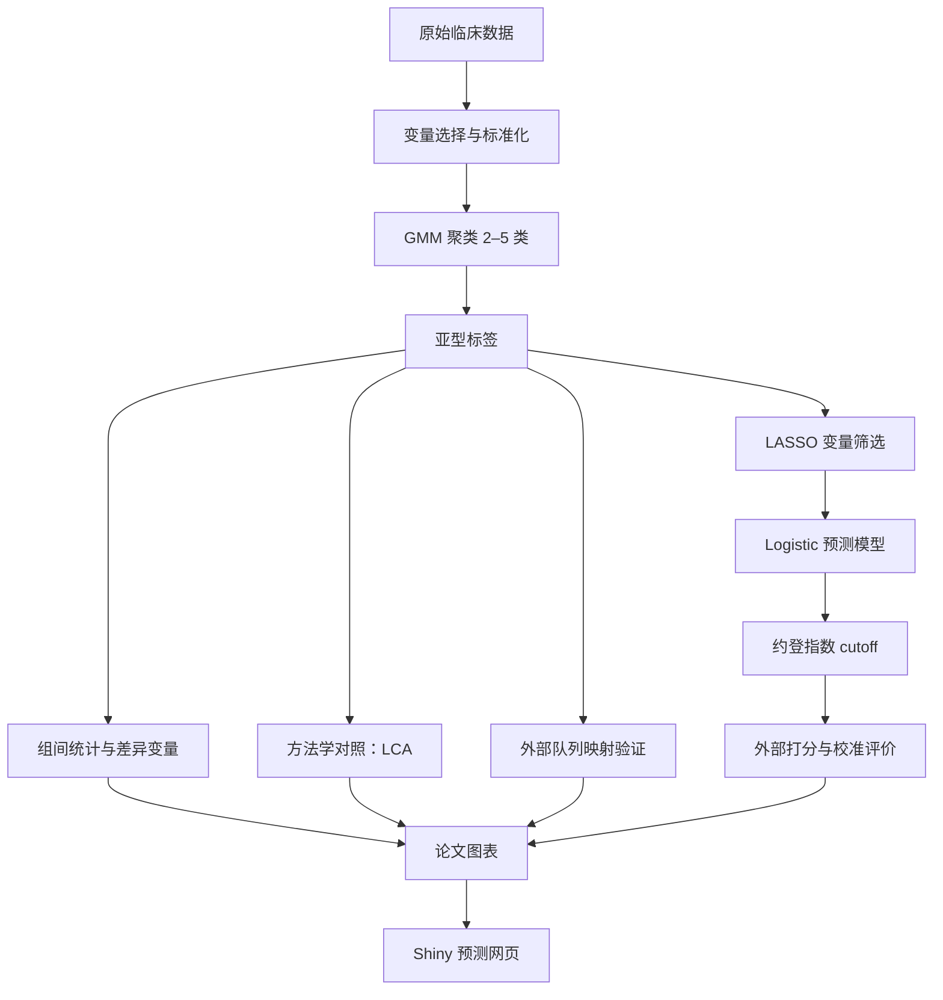

# HIV 相关脓毒症临床亚型聚类分析

**Clinical subphenotype clustering in HIV-associated sepsis**

本仓库是一个完整的 R 分析代码库：从 HIV 合并脓毒症患者中识别临床亚型，
在独立队列中验证，并构建可用于临床风险分层的预测模型与网页计算器。

> [!IMPORTANT]
> **本仓库不包含任何原始数据或患者级数据。**
> 所有 `*.xlsx`、`*.csv`、`*.RData` 均已被 `.gitignore` 屏蔽。
> 数据准备方式见 [`data/README.md`](data/README.md)。

---

## 1. 项目简介

### 1.1 背景

HIV 感染合并脓毒症患者的临床表型高度异质：部分患者以免疫抑制和机会性感染为主，
另一部分则表现为快速进展的多器官衰竭。把患者视为同质群体会掩盖这种差异，
也会削弱预后评估与治疗决策的准确性。聚类分析可以从多维临床与实验室指标中
识别潜在的亚型结构，为分层诊疗提供依据。

### 1.2 研究目的

1. 基于入院期临床与实验室指标，识别 HIV 相关脓毒症的稳定临床亚型；
2. 用文献常用的潜在类别分析（LCA）作方法学对照，检验分型的稳健性；
3. 在独立外部队列中验证亚型结构；
4. 构建可解释的 Logistic 预测模型与 Shiny 网页计算器，输出个体化亚型概率。

### 1.3 研究设计

| 项目 | 内容 |
|---|---|
| 研究类型 | 回顾性队列研究 + 外部队列验证 |
| 研究人群 | HIV 合并脓毒症的住院患者 |
| 推导队列 | MIMIC-IV 提取队列（约 1800 例；建模分析表 1690 例） |
| 外部验证 | 上海市第八人民医院（市八）队列（约 240 例） |
| 分型方法 | 高斯混合模型（GMM，`mclust`，2–5 类） |
| 方法学对照 | 潜在类别分析（`poLCA`） |
| 亚型命名 | **Subtype 1 — Immunosuppression-OI**（免疫抑制 / 机会性感染型）<br>**Subtype 2 — Sepsis-MOF**（脓毒症多器官衰竭型） |
| 预测模型 | LASSO → Logistic 回归 → 约登指数 cutoff |
| 应用形式 | Shiny 交互式亚型概率计算器 |

> 上述样本量为脚本与文件名中反映的分析规模；最终以论文报告为准。

---

## 2. 技术路线



---

## 3. 仓库特点

- **57 个 R 脚本**，按“分析阶段 → 具体用途 → 迭代版本”三级分类
- 覆盖聚类、验证、统计、建模、绘图、网页部署的完整链路
- 保留原始中文文件名与编号，便于与历史分析记录对应
- 每个模块都有明确的“主线脚本”，迭代版本单独归入 `04_迭代版本`
- 绘图脚本内置已汇总的 OR / 率 / p 值，**不含患者级数据**，可单独运行复现版式
- 所有脚本通过 R 4.4.0 `parse()` 语法检查
- 部署凭据已移除，改用环境变量

---

## 4. 目录结构

```
hiv-sepsis-clustering/
├── README.md
├── TERMS.md                        # 使用条款
├── packages.R                      # 依赖包安装与版本清单
├── data/
│   └── README.md                   # 数据放置说明（不含数据）
├── docs/
│   ├── pipeline.md                 # 分析流程、依赖关系与运行顺序
│   ├── code-index.md               # 57 个脚本索引（作用 / 类型 / 输入输出）
│   ├── input-output.md             # 输入 / 输出文件清单
│   ├── variable-dictionary.md      # 变量字典
│   └── notes.md                    # 整理说明与原工程对照
└── scripts/
    ├── 01_聚类分析/
    │   ├── 01_主分析/              # 主 GMM 聚类
    │   ├── 02_方法学对照/          # LCA 与数据转换
    │   ├── 03_外部验证/            # 外部队列映射
    │   └── 04_迭代版本/            # 早期 GMM 版本
    ├── 02_统计与校准/
    │   ├── 01_组间比较/            # 两两比较、差异变量
    │   ├── 02_校准评价/            # 校准曲线、H–L 检验
    │   ├── 03_数据准备/            # 文本清洗、缺失统计
    │   └── 04_迭代版本/            # 旧版 Logistic
    ├── 03_预测建模/
    │   ├── 01_主模型/              # LASSO + Logistic 主模型
    │   ├── 02_阈值与外部打分/      # 最终 cutoff 与外部打分
    │   ├── 03_简化模型/            # 简化模型与 BIC 逐步回归
    │   └── 04_迭代版本/            # 旧公式与旁支分析
    ├── 04_图表/
    │   ├── 01_聚类图/              # BIC 选择图、PCA 散点图
    │   ├── 02_森林图/              # 结局森林图 / 倾向性评分 / 市八干预与药物
    │   ├── 03_雷达图/              # 合并症、HIV 指标、严重程度
    │   ├── 04_生存曲线/            # KM
    │   ├── 05_热图/                # 细胞因子热图
    │   └── 06_构成与差异图/        # 柱状图、饼图、差异曲线
    └── 05_网页应用/
        ├── 01_最终版/              # 最终 Shiny 页面
        ├── 02_其他版本/            # UI 迭代版本
        └── 网页预测-部署-终.R      # 部署脚本（凭据走环境变量）
```

---

## 5. 快速开始

### 5.1 环境

- R ≥ 4.4.0（开发环境 R 4.4.0，Windows 11）
- 依赖包见 [`packages.R`](packages.R)

```r
source("packages.R")
```

国内网络可先切换镜像：

```r
options(repos = c(CRAN = "https://mirrors.tuna.tsinghua.edu.cn/CRAN/"))
```

### 5.2 准备数据

将输入表放入同一目录，并设置环境变量：

```r
Sys.setenv(SEPSIS_DATA_DIR = "D:/sepsis-data")
```

未设置时脚本默认使用 `D:/Desktop`。文件清单见
[`data/README.md`](data/README.md)。

### 5.3 运行

在 RStudio 中打开项目，按 [`docs/pipeline.md`](docs/pipeline.md) 的顺序运行；
或直接 `source()` 单个脚本。脚本开头的

```r
setwd(Sys.getenv("SEPSIS_DATA_DIR", unset = "D:/Desktop"))
```

会把工作目录切到数据目录，**所有相对路径的输出也写回该目录**（已被 `.gitignore` 屏蔽）。

---

## 6. 分析流程

| 阶段 | 目录 | 主要内容 | 建议入口 |
|---|---|---|---|
| 1 | `scripts/01_聚类分析/` | GMM 聚类（2–5 类）、BIC/AIC、TableOne、LCA 对照、外部映射 | `01_主分析/1-LCP.R` → `03_外部验证/3-外部验证.R` |
| 2 | `scripts/02_统计与校准/` | 组间两两比较、差异变量、校准曲线、H–L、缺失统计 | `01_组间比较/4-挑选最有差异变量.R`、`02_校准评价/4-校准图形绘制.R` |
| 3 | `scripts/03_预测建模/` | LASSO 稳定性、Logistic 系数、约登 cutoff、外部打分 | `01_主模型/3-lasso-log-cutoff1.R` → `02_阈值与外部打分/` |
| 4 | `scripts/04_图表/` | 森林图、雷达图、KM、细胞因子热图、饼图、差异曲线 | 按图选择 |
| 5 | `scripts/05_网页应用/` | 交互式亚型概率预测网页 | `01_最终版/网页预测-交互页面-终.R` |

完整的运行顺序、依赖关系与已知问题见
[`docs/pipeline.md`](docs/pipeline.md)。

---

## 7. 主要图表

| 图 | 脚本 |
|---|---|
| GMM 模型 BIC 选择图 | `scripts/04_图表/01_聚类图/0-绘制聚类统计图.R` |
| PCA 聚类散点图 | `scripts/04_图表/01_聚类图/0-绘制聚类图.R` |
| 结局森林图（MIMIC / 市八） | `scripts/04_图表/02_森林图/01_结局森林图/` |
| 倾向性评分五模型森林图 | `scripts/04_图表/02_森林图/02_倾向性评分/7-森林图4-有p值.R` |
| 干预 / 药物森林图（市八） | `scripts/04_图表/02_森林图/03_市八干预与药物/` |
| 雷达图（合并症、HIV 相关、疾病严重程度） | `scripts/04_图表/03_雷达图/1-简化雷达图数据图例版.R` 等 |
| Kaplan–Meier 曲线 | `scripts/04_图表/04_生存曲线/3-KM.R` |
| 细胞因子热图 | `scripts/04_图表/05_热图/21-细胞因子热图横置.R` |
| 结局饼图 | `scripts/04_图表/06_构成与差异图/5-绘制饼图.R` |
| 变量差异曲线 | `scripts/04_图表/06_构成与差异图/6-绘制差异曲线.R` |

---

## 8. 文档导航

| 文档 | 内容 |
|---|---|
| [`docs/pipeline.md`](docs/pipeline.md) | 分阶段流程、脚本作用与运行顺序 |
| [`docs/code-index.md`](docs/code-index.md) | 57 个脚本的完整索引（作用 / 类型 / 读 / 写） |
| [`docs/input-output.md`](docs/input-output.md) | 输入 / 输出文件清单 |
| [`docs/variable-dictionary.md`](docs/variable-dictionary.md) | 聚类与建模变量说明 |
| [`docs/notes.md`](docs/notes.md) | 整理说明、原工程对照与改动记录 |
| [`data/README.md`](data/README.md) | 数据放置与隐私说明 |
| [`TERMS.md`](TERMS.md) | 使用条款与免责声明 |

---

## 9. 使用条款

本仓库代码仅供学术研究与复现参考；未经作者许可，不得用于商业用途或二次发表。
原始数据不随代码提供。完整条款见 [`TERMS.md`](TERMS.md)。

---

## 10. 已知问题与命名说明

脚本保留原始文件名以便与历史分析记录对应，其中几处命名与实际内容不一致：

- `scripts/01_聚类分析/01_主分析/1-LCP.R` **实际是 GMM 聚类**，不是 LCA；
- `scripts/04_图表/02_森林图/03_市八干预与药物/肾素.R` **实际画的是肝素（Heparin）**；
- `scripts/04_图表/05_热图/4-细胞因子热图.R` **实际是 TyG × CD4 死亡热图**，
  聚类主线的细胞因子热图是 `21-细胞因子热图横置.R`；
- `scripts/02_统计与校准/04_迭代版本/4-log.R` 存在未定义变量 `categorical_vars`，
  正式结果请使用 `03_预测建模/01_主模型/2-逻辑回归系数生成.R`；
- `0-绘制聚类图.R`、`4-校准图形绘制两图放一起.R`、
  `3-lasso-log-精简构建公式.R` 依赖上游脚本的内存对象，不能单独运行。

详见 [`docs/pipeline.md`](docs/pipeline.md) 与各脚本头部注释。

---

## 11. 数据与伦理

- 原始数据、中间表、患者级信息**均未收录**，且被 `.gitignore` 屏蔽。
- 使用数据前需获得伦理委员会批准及数据使用授权。
- 部署脚本中的账号 / token / secret 已全部移除，请勿把真实凭据写回仓库。
