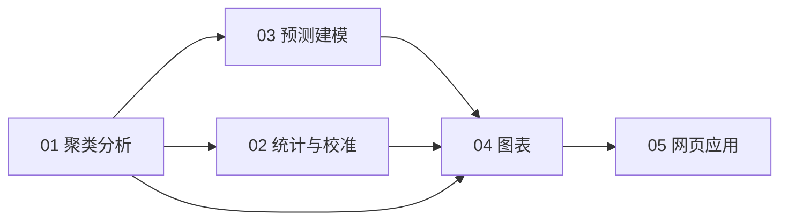

# 分析流程与脚本说明

> 脚本按“**分析阶段 → 具体用途 → 迭代版本**”三级分类，保留作者的中文文件名与编号。
> 编号重复（多个 `4-`）代表同一阶段的不同迭代版本，不是错误。

## 分类原则

| 层级 | 含义 |
|---|---|
| 一级目录 | 分析阶段：聚类 → 统计 → 建模 → 图表 → 网页 |
| 二级目录 | 具体用途：主分析、方法学对照、外部验证、校准评价等 |
| `04_迭代版本` / `02_其他版本` | 已被替代或仅作方法学参考的版本，保留以备追溯 |

每个阶段都有明确的**主线脚本**；日常复现只需运行主线，迭代版本按需查阅。

---

## 总览



所有脚本开头统一为：

```r
setwd(Sys.getenv("SEPSIS_DATA_DIR", unset = "D:/Desktop"))
```

输出默认写回数据目录。

---

## 01 聚类分析（`scripts/01_聚类分析/`）

### 01_主分析

| 脚本 | 作用 | 类型 | 关键输出 |
|---|---|---|---|
| `1-LCP.R` | 主 GMM 聚类（2–5 类）+ BIC/AIC + TableOne + 导出 | 主线 | `Cluster_Selection_Criteria.xlsx`<br>`Clustered_Data_Results.xlsx` |

### 02_方法学对照

| 脚本 | 作用 | 类型 | 关键输出 |
|---|---|---|---|
| `2-27-文献方法.R` | 文献方法：潜在类别分析（`poLCA`，1–5 类） | 主线 | 控制台输出 |
| `1-检验正态性.R` | Shapiro–Wilk 检验 + log / z-score 转换 | 工具 | `processed_data.xlsx` |

### 03_外部验证

| 脚本 | 作用 | 类型 | 关键输出 |
|---|---|---|---|
| `3-外部验证.R` | 推导队列 GMM 建模 + 外部队列映射（均值填补、标准化、哑变量对齐） | 主线 | `Cluster_Validation_Results.xlsx` |

### 04_迭代版本

| 脚本 | 作用 | 类型 | 关键输出 |
|---|---|---|---|
| `2--GMM所有连续变量.R` | 仅用连续变量的 GMM 变体 | 迭代 | `Clustered_Data.xlsx` |
| `1- GMM聚类.R` | 最早的 GMM 原型（需内存中已有 `data`） | 迭代 | `clustered_patient_data.csv` |

**运行要点**

- `1-LCP.R` 生成带 `cluster` 标签的数据，是后续统计与建模的基础；
- `3-外部验证.R` 独立读入推导与外部数据，不依赖 `1-LCP.R` 的内存对象；
- `1- GMM聚类.R` 假设工作区已有 `data`，不能单独运行。

---

## 02 统计与校准（`scripts/02_统计与校准/`）

### 01_组间比较

| 脚本 | 作用 | 类型 | 关键输出 |
|---|---|---|---|
| `1-组间两两比较.R` | 分类变量逐水平卡方 / Fisher 两两比较 | 主线 | `cluster_level_compare.xlsx` |
| `4-挑选最有差异变量.R` | 标准化均值差 Top5 差异变量 | 主线 | `variable_discrimination_scores.csv`<br>`top5_discriminative_variables.csv` |

### 02_校准评价

| 脚本 | 作用 | 类型 | 关键输出 |
|---|---|---|---|
| `4-校准图形绘制.R` | 校准曲线、H–L、Brier、AUC、Platt 重校准 | 主线 | `model_performance_summary.xlsx` |
| `4-校准图形绘制两图放一起.R` | 校准曲线 + H–L 柱状组合图 | 依赖 | 图形设备 |
| `5-Hosmer–Lemeshow校准统计分析.R` | Hosmer–Lemeshow 校准检验 | 主线 | 控制台输出 |

### 03_数据准备

| 脚本 | 作用 | 类型 | 关键输出 |
|---|---|---|---|
| `2-提取文字.R` | 肝素医嘱文本清洗（旁支数据准备） | 工具 | `33w-肝素_20250918.xlsx`<br>`脓毒症肝素治疗数据.xlsx` |
| `6-数据缺失统计.R` | 各变量缺失数与比例 | 工具 | `Missing_Data_Report.xlsx` |

### 04_迭代版本

| 脚本 | 作用 | 类型 | 关键输出 |
|---|---|---|---|
| `4-log.R` | 多变量 Logistic（cluster 为结局） | 迭代 | `Logistic_Model_Results.xlsx` |

**依赖关系**

- `4-校准图形绘制两图放一起.R` 使用 `4-校准图形绘制.R` 创建的
  `df_old_cal`、`df_new_cal` 对象，需在同一 R 会话中先运行后者。

---

## 03 预测建模（`scripts/03_预测建模/`）

### 01_主模型

| 脚本 | 作用 | 类型 | 关键输出 |
|---|---|---|---|
| `3-lasso-log-cutoff1.R` | **主建模**：10 次 CV LASSO → 全变量 / 显著变量 Logistic → 约登 cutoff | 主线 | `Regression_Results.xlsx`<br>`Risk_Scores.csv`<br>`项目摘要.xlsx` |
| `2-逻辑回归系数生成.R` | 全变量 Logistic 系数 / OR / 性能 | 主线 | `Logistic_Model_Results.xlsx` |

### 02_阈值与外部打分

| 脚本 | 作用 | 类型 | 关键输出 |
|---|---|---|---|
| `4-计算最大约登指数（校准后）.R` | **最终 cutoff**（校准后 11 变量公式） | 主线 | `Logistic_约登指数.xlsx` |
| `4-约登数筛选（校准后）.R` | **最终外部打分**（校准后公式） | 主线 | `240-11.xlsx` |

### 03_简化模型

| 脚本 | 作用 | 类型 | 关键输出 |
|---|---|---|---|
| `3-lasso-log-精简构建公式.R` | 对 LASSO 入选变量做 BIC 逐步回归 | 依赖 | `BIC_Logit_Results.csv` |
| `2-逻辑回归系数生成-简易模型.R` | 5 变量简化 Logistic | 迭代 | `Logistic_Model_Continuous_Results.xlsx` |

### 04_迭代版本

| 脚本 | 作用 | 类型 | 关键输出 |
|---|---|---|---|
| `1-lasso-逻辑.R` | 死亡结局的 LASSO 稳定性分析（旁支） | 迭代 | `LASSO_Results/<时间戳>/` |
| `4-计算最大约登指数（旧公式）.R` | 旧公式 cutoff | 迭代 | `Logistic_约登指数.xlsx` |
| `4-约登数筛选（旧公式）.R` | 旧公式外部打分 | 迭代 | `240-6.xlsx` |

**运行要点**

- 先运行 `3-lasso-log-cutoff1.R`，再运行 `3-lasso-log-精简构建公式.R`
  （后者直接使用前者的 `results_df`、`x`、`y`、`regression_dir`）；
- 最终 cutoff 与外部打分以 `02_阈值与外部打分/` 两个脚本为准；
- `1-lasso-逻辑.R` 的结局是死亡而非 cluster，属旁支分析。

---

## 04 图表（`scripts/04_图表/`）

### 01_聚类图

| 脚本 | 图 | 类型 |
|---|---|---|
| `0-绘制聚类统计图.R` | 13 个 GMM 模型的 BIC 折线图（内置汇总数据） | 主线 |
| `0-绘制聚类图.R` | PCA 聚类散点图（依赖 `1-LCP.R` 对象） | 依赖 |

### 02_森林图

| 脚本 | 图 | 类型 |
|---|---|---|
| `01_结局森林图/1-正式版结局森林图-mimic.R` | MIMIC 结局森林图 | 主线 |
| `01_结局森林图/2-结局森林图-市八.R` | 市八结局森林图 | 主线 |
| `01_结局森林图/结局森林图.R` | 结局森林图初稿 | 迭代 |
| `02_倾向性评分/7-森林图1.R` … `7-森林图4-有p值.R` | 倾向性评分五模型森林图（1→4 迭代，4 为最终） | 迭代 |
| `03_市八干预与药物/ART.R` | 市八 ART 森林图 | 主线 |
| `03_市八干预与药物/IMV.R` | 市八 IMV 森林图 | 主线 |
| `03_市八干预与药物/糖皮质激素.R` | 市八糖皮质激素森林图 | 主线 |
| `03_市八干预与药物/肾素.R` | 市八肝素森林图（文件名误写） | 主线 |
| `03_市八干预与药物/血管活性药物.R` | 市八血管活性药物森林图 | 主线 |

### 03_雷达图

| 脚本 | 图 | 类型 |
|---|---|---|
| `1-简化雷达图数据图例版.R` | 最终双组雷达图 + 手工图例 | 主线 |
| `1-简化雷达图-显著性版.R` | 雷达图 + p 值星号变体 | 迭代 |
| `1-简化双雷达图.R`、`1-简化雷达图.R` | 雷达图前身 | 迭代 |
| `1-简化雷达图数据储存.R` | 多套雷达图数值草稿（不绘图） | 工具 |
| `1-雷达图.R`、`1-雷达图hiv相关.R`、`1-雷达图疾病严重程度.R` | `ggradar` 初版 | 迭代 |

### 04_生存曲线

| 脚本 | 图 | 类型 |
|---|---|---|
| `3-KM.R` | 28 天 KM 生存曲线 + 风险表 | 主线 |

### 05_热图

| 脚本 | 图 | 类型 |
|---|---|---|
| `21-细胞因子热图横置.R` | 细胞因子热图（聚类主线） | 主线 |
| `4-细胞因子热图.R` | TyG × CD4 死亡热图（旁支） | 迭代 |

### 06_构成与差异图

| 脚本 | 图 | 类型 |
|---|---|---|
| `2-柱状图.R` | CD4 / 病毒载量分层柱状图 | 主线 |
| `5-绘制饼图.R` | 两 cluster 结局饼图 | 主线 |
| `6-绘制差异曲线.R` | 镜像 z-score 差异曲线 | 主线 |

> 绘图脚本大多把已汇总的 OR / 率 / p 值直接写在脚本里，**不含患者级数据**，
> 可单独运行复现图形版式。`ggsave()` 多数被注释，需要时取消注释即可。

---

## 05 网页应用（`scripts/05_网页应用/`）

### 01_最终版

| 脚本 | 作用 | 类型 |
|---|---|---|
| `网页预测-交互页面-终.R` | 最终交互页面（概率条 + 变量贡献图 + 临床解释） | 主线 |

### 02_其他版本

| 脚本 | 作用 | 类型 |
|---|---|---|
| `网页预测-及时生成gpt.R` | GPT 生成的 UI 变体 | 迭代 |
| `网页预测-及时生成元宝.R` | 功能最全的变体（plotly 仪表盘、Tab 分组） | 迭代 |
| `网页预测-交互页面.R` | 旧版 shinydashboard 页面 | 迭代 |
| `网页预测.R` | 最老原型（占位模型） | 迭代 |

### 部署脚本

| 脚本 | 作用 | 类型 |
|---|---|---|
| `网页预测-部署-终.R` | `rsconnect` 部署脚本（凭据改为环境变量） | 工具 |

启动最终页面：

```r
shiny::runApp("scripts/05_网页应用/01_最终版/网页预测-交互页面-终.R")
```

部署前设置 `SHINYAPPS_NAME`、`SHINYAPPS_TOKEN`、`SHINYAPPS_SECRET`，
然后在项目根目录运行：

```bash
Rscript scripts/05_网页应用/网页预测-部署-终.R
```

---

## 建议运行顺序

1. `01_聚类分析/01_主分析/1-LCP.R` → 得到聚类标签与选择标准
2. `01_聚类分析/03_外部验证/3-外部验证.R` → 外部映射结果
3. `03_预测建模/01_主模型/3-lasso-log-cutoff1.R` → 主模型
4. `03_预测建模/02_阈值与外部打分/4-计算最大约登指数（校准后）.R` → 最终 cutoff
5. `03_预测建模/02_阈值与外部打分/4-约登数筛选（校准后）.R` → 外部打分
6. `02_统计与校准/` → 组间比较、校准、缺失统计
7. `04_图表/` → 论文图
8. `05_网页应用/01_最终版/网页预测-交互页面-终.R` → 网页

> 方法学对照可在第 1 步后运行：
> `01_聚类分析/02_方法学对照/1-检验正态性.R` → `2-27-文献方法.R`。

---

## 已知问题

| 脚本 | 问题 / 说明 |
|---|---|
| `01_聚类分析/01_主分析/1-LCP.R` | 文件名含 LCP，实际是 GMM；`gmm$models[[as.character(k)]]` 在部分 `mclust` 版本下可能取到 `NA`，运行后请核对导出表 |
| `01_聚类分析/04_迭代版本/1- GMM聚类.R` | 依赖内存中的 `data`，不能单独运行 |
| `02_统计与校准/04_迭代版本/4-log.R` | `categorical_vars` 未定义；ROC 结局与模型结局不一致 |
| `04_图表/01_聚类图/0-绘制聚类图.R` | 依赖 `1-LCP.R` 的 `data_cluster`、`data$cluster`、`best_k` |
| `02_统计与校准/02_校准评价/4-校准图形绘制两图放一起.R` | 依赖 `4-校准图形绘制.R` 的 `df_old_cal`、`df_new_cal` |
| `03_预测建模/03_简化模型/3-lasso-log-精简构建公式.R` | 依赖 `3-lasso-log-cutoff1.R` 的内存对象 |
| `02_统计与校准/02_校准评价/4-校准图形绘制.R` | 用 `cluster0` 构造 `死亡终_num`，字段含义需结合原始数据核对 |
| `04_图表/05_热图/4-细胞因子热图.R` | 字体设置 `times.ttf` 为 Windows 路径，其他系统需调整 |
